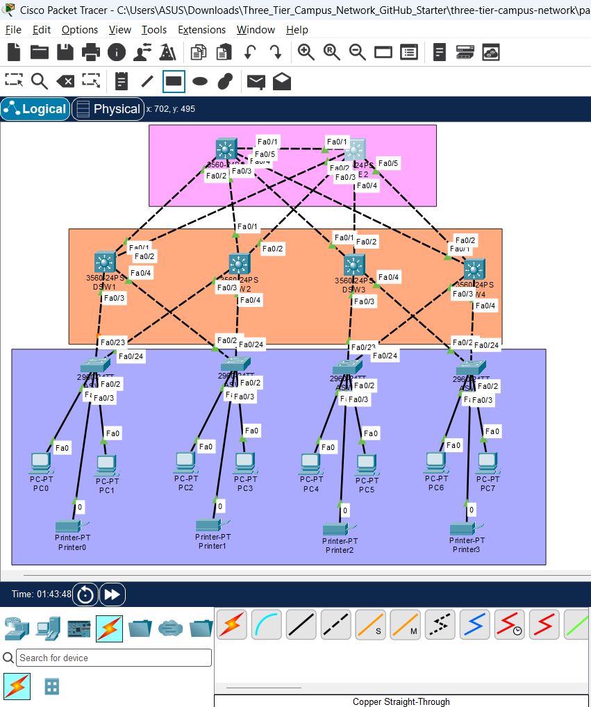

# Three-Tier Hierarchical Network Design

A three-tier hierarchical campus network designed and configured using **Cisco Packet Tracer 9.0**.

## Network Topology

## Network Components

- 2 Core Layer Multilayer Switches (Cisco 3560)
- 4 Distribution Layer Multilayer Switches (Cisco 3560)
- 4 Access Layer Switches (Cisco 2960)
- 8 PCs
- 4 Network Printers

## Technologies Implemented

- VLAN Configuration (VLAN 10, 30, 99)
- Inter-VLAN Routing
- HSRP Gateway Redundancy
- Rapid-PVST Spanning Tree Protocol
- 802.1Q Trunking
- DHCP Configuration
- Static IP Addressing
- Redundant Network Connections

## Testing Results

- PC DHCP Configuration – PASS
- VLAN Gateway Connectivity – PASS
- Inter-VLAN Communication – PASS
- All Four Printer Connections – PASS
- HSRP Failover Testing – 2/2 PASSED

## Project Information

**Software:** Cisco Packet Tracer 9.0

**Architecture:** Three-Tier Hierarchical Network

**Status:** Successfully implemented and tested.

This project demonstrates practical knowledge of enterprise network design, switching, routing, VLAN segmentation, redundancy, and network troubleshooting.
